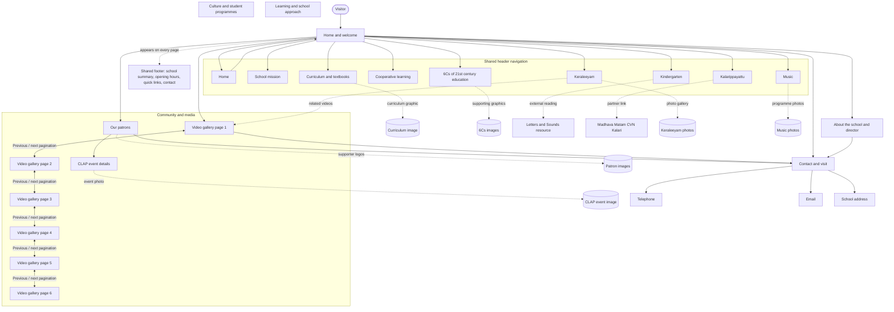
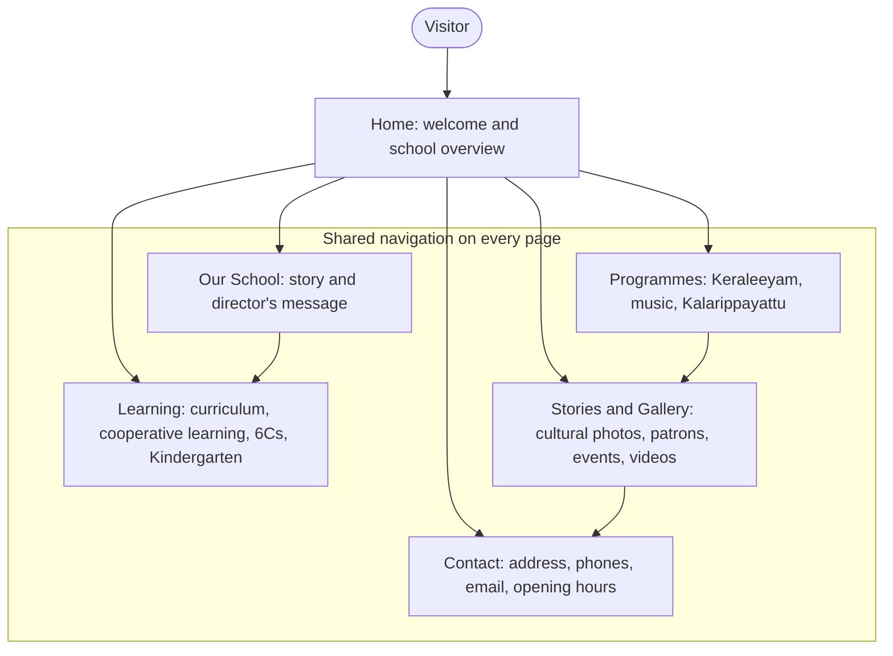

# Ananthamurthy International School

## Website Information Flow

This map reflects the public pages and links found on `ananthamurthyacademy.org`. The school logo and shared header/footer are available throughout the site; the header provides the main section links and the footer repeats key destinations and contact details.

## Information Flow in the Local Rebuild

The current local build groups the source site's 19 pages into five simpler destinations. This is the navigation visitors use in the rebuilt site; the map above preserves the detailed page structure found during the source-site crawl.

### Source-to-Rebuild Page Mapping

| Live source page or section | Local rebuild destination |
| --- | --- |
| Home (`/`, `index.html`) | Home (`index.html`) |
| About (`about-us.html`) and School Mission (`school-mission.html`) | Our School (`about.html`) |
| Curriculum (`curriculum-textbooks.html`), Cooperative Learning (`cooperative-learning.html`), 6Cs (`6-cs-of-education-classroom.html`), Kindergarten (`kindergarten.html`) | Learning (`academics.html`) |
| Keraleeyam (`keraleeyam-event.html`), Music (`music.html`), Kalarippayattu (`kalari.html`) | Programmes (`programs.html`) |
| Our Patrons (`academy-events.html`), CLAP event (`academy-events-details.html`), Videos (`academy-video.html` through `academy-video-six.html`), Keraleeyam photo gallery and video section | Stories &amp; Gallery (`gallery.html`) |
| Contact (`contact-us.html`) | Contact (`contact.html`) |

## Page-by-Page Content

| Page | Information available | Media and onward links |
| --- | --- | --- |
| Home (`/`, `index.html`) | Welcome, executive director's message, the Wings & Roots idea, school introduction, and entry points to the site's learning and programme sections. | Nine homepage banners and school logo; links into the main sections, patrons, videos, contact, and the director's letter. |
| About (`about-us.html`) | School overview and the executive director's letter; cooperative learning, the Cambridge syllabus, Kerala heritage, compulsory activities, and the school's charitable trust are described. | Director/Ananthamurthy image; contact details. |
| School Mission (`school-mission.html`) | The school's purpose and six aims covering achievement, joyful learning, community, Kerala heritage, citizenship, and environmental care. | Links back to the shared site navigation. |
| Curriculum & Textbooks (`curriculum-textbooks.html`) | Cambridge Primary and Lower Secondary, the blend with Kerala/Indian state curriculum, social constructivism, assessment, and parent guidance about textbooks and tutoring. | Curriculum graphic and external curriculum/reference links. |
| Cooperative Learning (`cooperative-learning.html`) | Five cooperative-learning pillars and reported academic, reasoning, relationship, and wellbeing outcomes. | Research link to the Cooperative Learning Institute. |
| 6Cs (`6-cs-of-education-classroom.html`) | Critical thinking, creativity, collaboration, communication, citizenship, and character, with how these are incorporated into lessons. | Two 6Cs graphics and an external Education Plus reference. |
| Kindergarten (`kindergarten.html`) | Cambridge Early Years KG-1 (ages 3–4) and KG-2 (ages 4–5), social/emotional development, motor skills, phonics, early science/maths readiness, and physical development. | Link to the UK Letters and Sounds resource. |
| Keraleeyam (`keraleeyam-event.html`) | Kerala history and cultural heritage integrated with Malayalam learning, including visits to culturally and historically important places. | Nine locally downloaded gallery photos and related video pages. |
| Music (`music.html`) | Eastern music, including Carnatic vocal, Sopanasangeetham, and folk songs; western music instruction is also described. | Two programme images. |
| Kalarippayattu (`kalari.html`) | Compulsory training, its stated aims, and the school's training partnership. | Three programme images and a link to the Madhava Matam CVN Kalari Ayurvedic Centre. |
| Our Patrons (`academy-events.html`) | Support from Cochin Shipyard, New Rajasthan Marbles, Kris Gopalakrishnan, and Manappuram Foundation. | Three patron logos; link to CLAP event details. |
| CLAP event (`academy-events-details.html`) | Dedicated event page for CLAP. | CLAP event photo. |
| Video gallery (`academy-video.html`, `academy-video-two.html`, `academy-video-three.html`, `academy-video-four.html`, `academy-video-five.html`, `academy-video-six.html`) | Six paginated video-gallery pages. | Previous/next pagination connects the six pages; the Keraleeyam page also has a related videos section. |
| Contact (`contact-us.html`) | School and Foundation address, two telephone numbers, email, and opening hours. | Telephone and email actions; shared footer and site navigation. |

## Shared Navigation and External Resources

- The site logo returns visitors to Home. The shared header links to the learning and programme pages; shared footer links include Our Patrons, Videos, and Contact Us.
- Contact details published on the source site: SNRA No. A-4, Surya Nagar, near Central Polytechnic, Vattiyoorkavu, Thiruvananthapuram 695 013; +91 471 236 6166; +91 9605 080 597; `principal@ananthamurthyacademy.org`.
- Published opening hours: Monday to Friday, 9:00 AM–4:00 PM; Saturday and Sunday closed.
- Source media gathered for the rebuild is stored under `assets/images/`, grouped by its original content area (`images`, `keraleeyam`, and `events`). The local set includes 32 files — but see the correction below: the 8 files under `keraleeyam/` are textbook scans, not photographs, and are no longer shown as gallery photos.
- **Correction:** all 8 files in `assets/images/keraleeyam/` turned out to be scanned pages from a Malayalam-medium textbook (Onam/Vallam Kali, Ramadan, Vishu, Christmas — general Kerala-festival curriculum material), not photographs of the school's own Keraleeyam programme or students. They had been mislabeled as "Keraleeyam cultural learning" photos in the rebuilt Gallery. That label has been removed from the gallery grid; the 8 files remain on disk but are no longer displayed as gallery photos. The school has **no real photograph of its own Keraleeyam activities** in the downloaded set — this should be requested from the school.
- In its place, the Gallery's Keraleeyam tile now uses one properly licensed reference photo sourced from Wikimedia Commons — Padmanabhapuram Palace (CC BY-SA 4.0, © Timothy A. Gonsalves), a real heritage site the school's Keraleeyam programme visits per its own video library (see Video Research below). It is stored at `assets/images/external/padmanabhapuram-palace-wikimedia.jpg`, captioned in the UI as a reference photo (not the school's own) with full attribution and license, consistent with CC BY-SA's attribution requirement.
- The source domain currently exposes a mixture of legacy pages and content. Verify time-sensitive claims, affiliations, programme details, and contact information with the school before publishing changes.

## Video Research

- All six paginated video-gallery pages and the Keraleeyam page's "Videos" section embed videos from the school's own official YouTube channel, **Ananthamurthy International** (`https://www.youtube.com/@ananthamurthyinternational4855`), confirmed via YouTube's public oEmbed API for each video checked. Across the six pages there are roughly 100 embedded videos in total; most (from page 3 onward) carry no real caption in the source markup — their `<iframe title>` is the generic placeholder "YouTube video player" rather than a real title.
- The rebuilt Gallery page (`gallery.html`) embeds a curated set of 8 of these videos, chosen for having real, verified titles (confirmed individually via oEmbed, since a few of the source page's `<iframe title>` attributes do not match the video's actual YouTube title) and for relevance to content already covered in the rebuild (Kalarippayattu, music, Keraleeyam cultural visits, drama, and classroom/academic life). A "More on the school's YouTube channel" link points visitors to the full channel rather than reproducing the entire uncaptioned set.
- The Keraleeyam page's video section also embeds two videos from the Executive Director's personal Facebook profile (`facebook.com/sureshkumar1957`). These were **not** replicated in the rebuild — embedding a personal social account on the school's rebuilt site needs the school's explicit sign-off, which is outside what this rebuild can confirm.
- Two previously unused downloaded graphics — `cs_01.png` (a plain-text summary of the Six Cs) and `cs_02.jpg` (an "Approach to Learning" diagram tying the 5E model, the Six Cs, and cooperative learning together) — are now shown on Learning (`academics.html`) as supporting graphics, matching the "6Cs images" entry in the source-site map above.
- A third downloaded graphic, `curriculam-img.jpg` ("Cambridge Pathway"), remains unused. It depicts a Cambridge Primary→Advanced pathway through age 19 with IGCSE/O Level and A Level stages — the same unsupported claims already excluded from the rebuilt Learning page per the brief (no A Levels, no age-19 claims). It should only be reintroduced if the school confirms it currently offers that full pathway.

## Visual Redesign Concept

- `concept-home.html` (project root) is a homepage concept in a more editorial/heritage direction, benchmarked against `westminster.org.uk` at the user's request. It is a standalone file, not wired into the shared navigation or `components.js`, and does not replace `index.html`.
- Direction: mostly neutral palette (warm paper, near-black ink) with one muted gold accent, serif display type (Fraunces) paired with Public Sans, full-bleed documentary photography instead of dark-overlay hero text, text-link CTAs instead of pill buttons, hairline rules instead of solid color blocks, no emoji icons.
- Built only from real downloaded photos plus the one licensed Wikimedia reference photo described above — no stock imagery presented as the school's own, no new claims beyond what the live site already states.
- Pending: the user is reviewing this concept before it is extended to `about.html`, `academics.html`, `programs.html`, `gallery.html`, and `contact.html`.